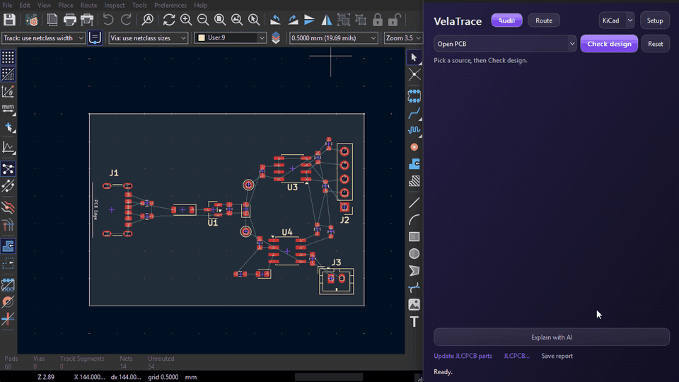

# VelaTrace

**Catch small PCB mistakes before you order. A free KiCad 10 plugin.**

[-314cb0)](https://www.kicad.org/)

  

Recorded on the demo board in <a href="examples/velatrace-demo">examples/velatrace-demo</a>, which has deliberately planted issues. Waiting time is cut; the route took about 10 seconds.

## Why I built this

I ordered boards with mistakes I had missed. Each one cost me a re-order.

So I made a button. Click **Check design** and in about a second you get a short list of things to look at, with the evidence and a suggested fix. It only reads your board. No account, no key, no network.

## What it has found

- On one open-source board: **48 capacitors** labelled "10u" that all carried the part number of a **1 µF** part.
- On another: **7 resistors** of different values sharing **one 1 k part number**.

The second kind of find needs the optional JLCPCB parts list. I have tried it on three boards so far.

## What it checks

- LEDs with no series resistor.
- I2C pull-up problems.
- Duplicated chips, 0 Ω shorts, unset values.
- Messy part values (`100n` vs `0.1uF` vs `100nF`).
- Wrong or out-of-stock JLCPCB part numbers (optional parts list).
- Early high-speed checks (beta): timing differences between paired lines and missing return paths, shown as notes.

Full list: [docs/behavior-and-limits.md](docs/behavior-and-limits.md#built-in-audit-checks). You can also save a shareable offline report: [docs/report.md](docs/report.md).

## Install in 3 steps

You need KiCad 10 (tested on Windows only).

1. In KiCad open the **Plugin and Content Manager**, search for **VelaTrace**, click **Install**, then **Apply Pending Changes**. If it is not listed yet, download `VelaTrace-v0.1.0-alpha.2-pcm.zip` from the [v0.1.0-alpha.2 release](https://github.com/F-Blaze/VelaTrace/releases/tag/v0.1.0-alpha.2) and use **Install from File...**. (If you installed earlier with `git clone`, delete that `plugins/VelaTrace` folder first.)
2. When KiCad asks to enable the KiCad API, click **Yes**. (Missed it? **Preferences > Plugins**, tick **Enable KiCad API**.)
3. Open the PCB Editor. The first start installs about 300 MB of Python packages (about 4 minutes for me), then a VelaTrace button appears. Click it, then **Check design**.

No button? **Preferences > Plugins**, right-click VelaTrace, **Recreate Plugin Environment**. More help: [docs/install.md](docs/install.md).

## Try it safely

Open the demo board in [examples/velatrace-demo](examples/velatrace-demo) (also on the release page as `velatrace-demo-v0.1.0-alpha.2.zip`). It has mistakes planted on purpose. The check only reads your board, so nothing changes.

## Routing (optional)

VelaTrace also has its own router, **Vela-routing**, for small boards. Click **Route board** and you get a preview on the board, then KiCad's design check (DRC) runs on it. If you like it, click **Approve** and the copper is added in one step. One **Undo** takes it back.

How it did on 13 test boards: its routes passed KiCad's check in 20 of 39 runs, against 8 of 33 for Freerouting. 5 of those Freerouting misses were the plugin stopping the board before Freerouting ran. This is one small test set on one PC, so treat it as a hint. How it works and what was measured: [docs/VELA_ROUTING.md](docs/VELA_ROUTING.md).

Before routing, see [Details](#details) for the few settings it needs. Try it on a disposable copy first.

## Honest limits

- It is an **alpha**. Expect rough edges.
- **KiCad 10 only**, and **tested on Windows only**.
- It is a first pass, not a design review. On 12 boards it had never seen, about **44%** of its warnings were right. The judges were AI reviewers, not human engineers.
- It finds only a minority of what a reviewer would raise. Treat every result as a hint.
- I built it with AI help. That is exactly why I measured it. Numbers and method: [Details](#details).

## Feedback

Found a wrong or missing finding? Please file an [audit false positive](https://github.com/F-Blaze/VelaTrace/issues/new?template=audit_false_positive.yml) report. Bugs and ideas are welcome too.

## Privacy

Offline by default. Anything that uses the network is opt-in and listed in [docs/privacy.md](docs/privacy.md).

## Other tools worth a look

- [KiCadRoutingTools](https://github.com/drandyhaas/KiCadRoutingTools): its own router, differential pairs, length matching, BGA/QFN fanout.
- [kicad-happy](https://github.com/aklofas/kicad-happy): datasheet-aware design review.
- [kicad-jlcpcb-tools](https://github.com/Bouni/kicad-jlcpcb-tools): a mature JLCPCB workflow. VelaTrace's JLCPCB part is newer and narrower.

## Contributing

Contributions, forks and bug reports are welcome. Start with [CONTRIBUTING.md](CONTRIBUTING.md) and the [good first issues](https://github.com/F-Blaze/VelaTrace/labels/good%20first%20issue). Security reports: [SECURITY.md](SECURITY.md). I maintain this alone, with no response-time guarantee.

## License

[MIT](LICENSE), including Vela-routing. **Route board** no longer runs Freerouting (GPLv3). The old Freerouting adapter and its MIT launcher `WarmRouter.java` stay in the repo for research benchmarks only and load a separately downloaded, unmodified Freerouting JAR. Whether the two form a combined work is an open question I am reviewing; this README makes no legal claim either way.

The optional JLCPCB data files carry no licence statement, and the live lookup uses an undocumented JLCPCB website endpoint. See [docs/jlcpcb.md](docs/jlcpcb.md) and [docs/bom.md](docs/bom.md).

## Details

**More docs:** [UI guide](docs/ui.md), [behavior and limits](docs/behavior-and-limits.md), [write safety](docs/write-safety.md), [JLCPCB parts](docs/jlcpcb.md), [BOM tidy-ups](docs/bom.md).

**Before routing.** Save the board and project once. Enable the **User.9** layer for previews. Set every KiCad DRC check to at least *Warning* (VelaTrace refuses to route while any is *Ignore*; KiCad's defaults ignore five). Routing needs a `kicad-cli` that matches the running editor exactly, patch version included; if it is not found, enter its path in **Setup**. It routes only placed, unrouted boards (one track width and clearance for all nets, no differential pairs, no BGA fanout) and refuses anything else. Dense boards often end as a partial route you can reject. **Approve anyway** applies a route that failed DRC, after a confirmation. DRC-clean does not mean electrically correct. Steps: [docs/install.md](docs/install.md).

**Optional AI explanations.** Bring your own key (Gemini or any OpenAI-compatible endpoint) in **Setup**. Token counts and a hard call budget are shown first; the key stays in memory. Setup values: [docs/install.md](docs/install.md).

**How accuracy was measured.** The reviewers and the judge were AI agents (Claude Opus), not human experts; I decided 5 borderline cases. 44% of findings were judged correct on 12 open-source boards (27% if unjudged findings count as wrong). Four rules that were wrong too often (`decoupling.missing`, `i2c.pullup.missing`, `net.single_pin`, `pin.input_floating`) show as Info notes only.

**JLCPCB parts list.** Opt-in download of about 181 MB (800 MB on disk), from the public data of the kicad-jlcpcb-tools project. It gives an offline table with tier, stock and price, flags mismatched LCSC numbers, writes the LCSC field to the board in one undoable step, and exports JLCPCB BOM, placement and Gerber files. It cannot edit the schematic (a KiCad 10 limit).

**Tested on** KiCad 10.0.4 and 10.0.6 on Windows. Linux and macOS are untested. To run the UI on fake data: `pip install -e '.[dev]'` then `python -m velatrace --demo`. Tests: `python -m pytest` (no key or KiCad needed).
